# 📚 Perpustakaan API

REST API **Laravel 12** (PHP 8.3) untuk manajemen data buku perpustakaan, lengkap dengan login berbasis token **Laravel Sanctum** dan dokumentasi interaktif **OpenAPI / Swagger UI** (L5-Swagger, memakai PHP Attributes `#[OA\...]`).

---

## 🧰 Teknologi

- Laravel 12 + PHP 8.3
- Laravel Sanctum (autentikasi token API)
- darkaonline/l5-swagger (Swagger UI + generator OpenAPI)
- MySQL / SQLite (sesuai konfigurasi `.env`)

## 🔗 Daftar Endpoint

| Method | Endpoint | Fungsi | Login? |
|---|---|---|---|
| POST | `/api/register` | Daftar akun, dapat token | Tidak |
| POST | `/api/login` | Login, dapat token | Tidak |
| GET | `/api/me` | Profil user yang login | Ya |
| POST | `/api/logout` | Hapus token aktif | Ya |
| GET | `/api/books` | Daftar buku (paginasi + pencarian) | Ya |
| POST | `/api/books` | Tambah buku | Ya |
| GET | `/api/books/{book}` | Detail buku | Ya |
| PUT/PATCH | `/api/books/{book}` | Ubah buku | Ya |
| DELETE | `/api/books/{book}` | Hapus buku | Ya |

---

## ⚙️ Instalasi & Menjalankan Proyek

```bash
# 1. Install dependency
composer install

# 2. Salin & atur environment
cp .env.example .env
php artisan key:generate

# 3. Atur database di .env, lalu tambahkan konfigurasi Swagger
#    APP_URL=http://localhost:8000
#    L5_SWAGGER_CONST_HOST=http://localhost:8000
#    L5_SWAGGER_GENERATE_ALWAYS=true

# 4. Migrasi + seeder
php artisan migrate:fresh --seed

# 5. Generate dokumentasi & jalankan server
php artisan l5-swagger:generate
php artisan serve
```

Akun demo (dari seeder): `admin@perpustakaan.com` / `password`

---

## 🧪 Hasil Pengerjaan (Bukti Screenshot)

### 1. Dokumentasi Swagger UI

Dokumentasi dihasilkan dari PHP Attributes `#[OA\...]` dan dibuka di `/api/documentation`.

tampilan halaman Swagger UI (daftar semua endpoint)

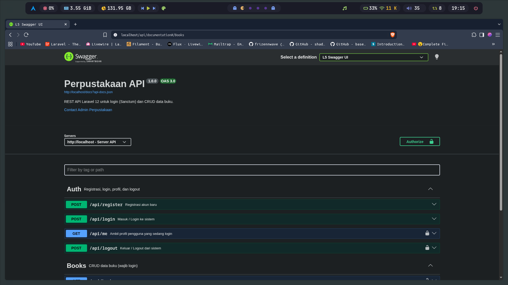

---

### 2. Pengujian Autentikasi

#### 2.1 Register — `POST /api/register`

request & response register (status 201)

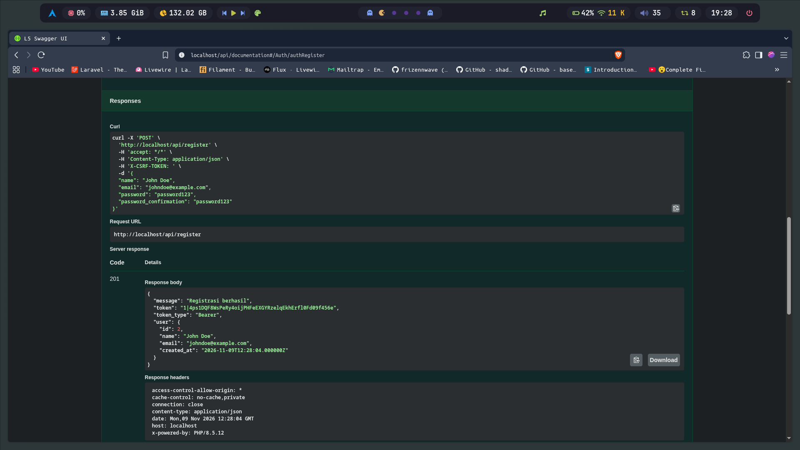

#### 2.2 Login berhasil — `POST /api/login`

login dengan `admin@example.com` / `password` (status 200, ada token)

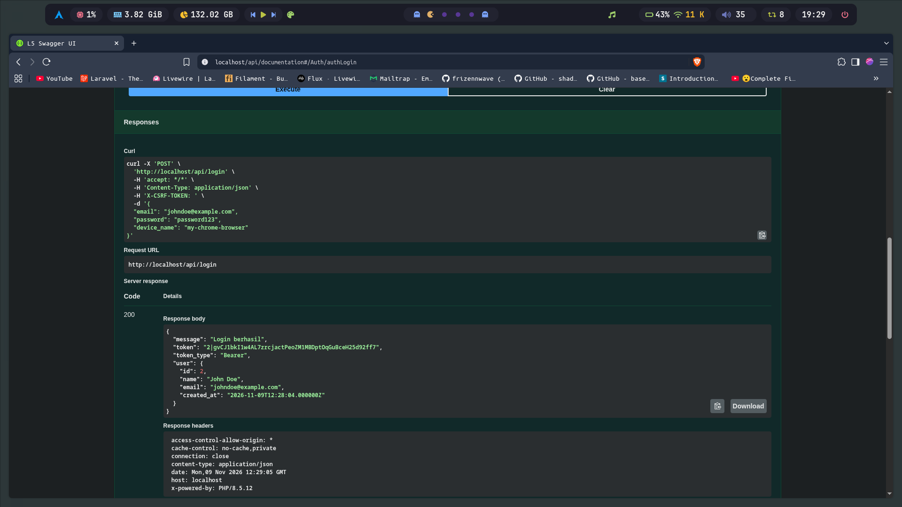

#### 2.3 Authorize di Swagger UI

dialog Authorize berisi token (tanpa kata "Bearer")

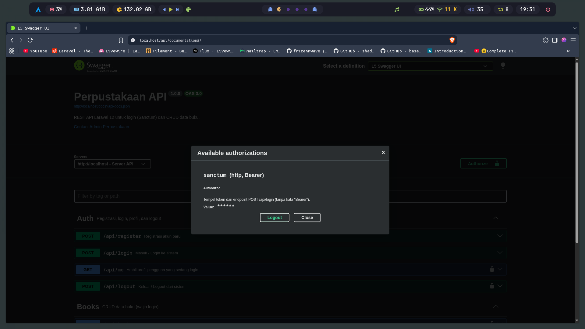

#### 2.4 Profil user — `GET /api/me`

respons profil user (status 200)

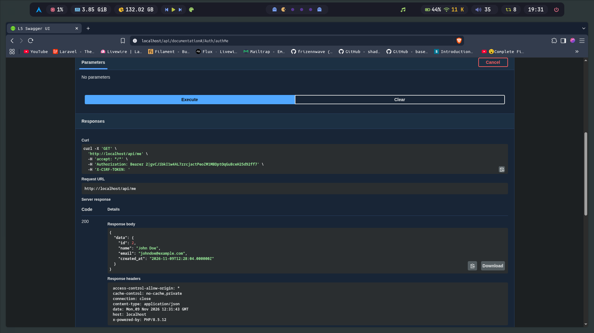

---

### 3. Pengujian CRUD Buku

#### 3.1 Daftar buku — `GET /api/books`

daftar buku dengan paginasi (status 200)

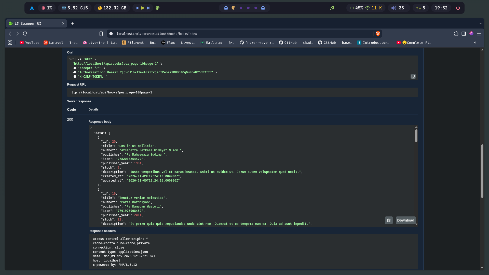

#### 3.2 Pencarian buku — `GET /api/books?search=...`

hasil pencarian berdasarkan judul/penulis

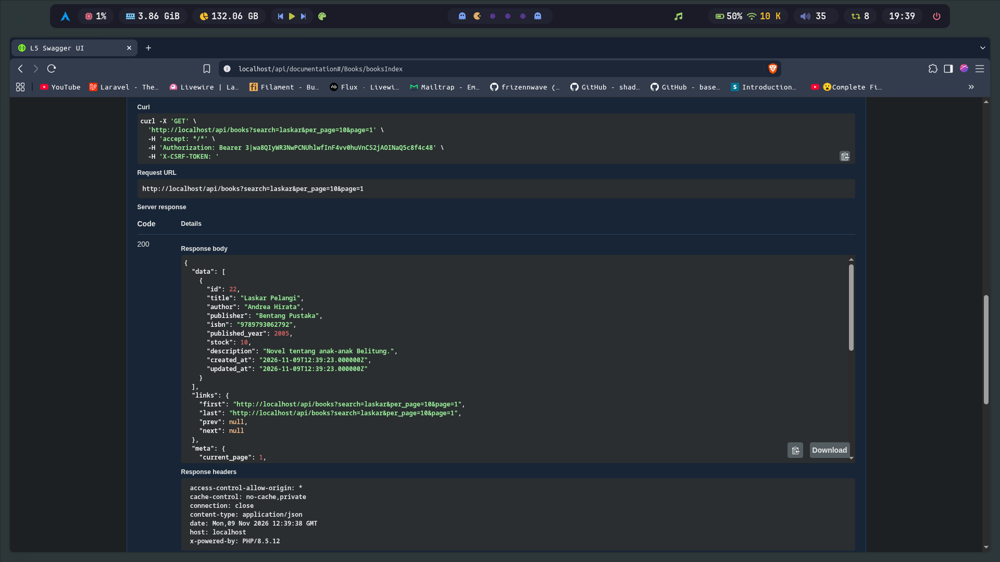

#### 3.3 Tambah buku — `POST /api/books`

tambah buku baru (status 201)

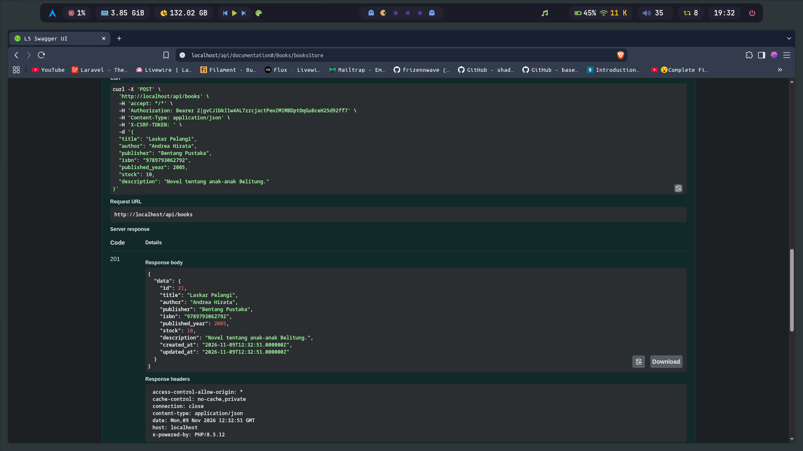

#### 3.4 Detail buku — `GET /api/books/{book}`

detail satu buku (status 200)

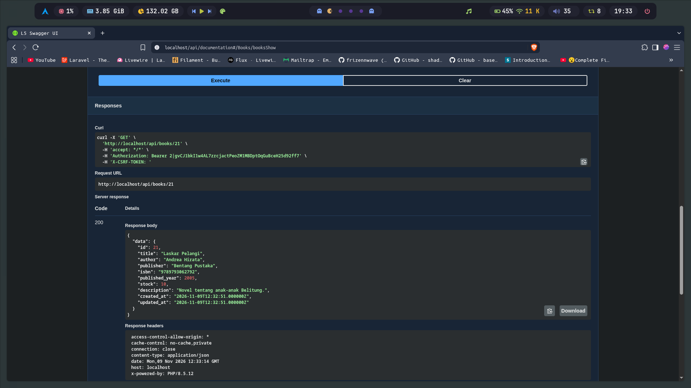

#### 3.5 Ubah buku — `PUT/PATCH /api/books/{book}`

ubah data buku (status 200)

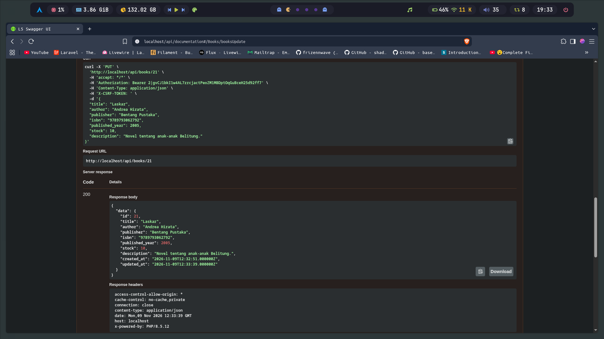

#### 3.6 Hapus buku — `DELETE /api/books/{book}`

hapus buku (status 200, pesan "Buku berhasil dihapus")

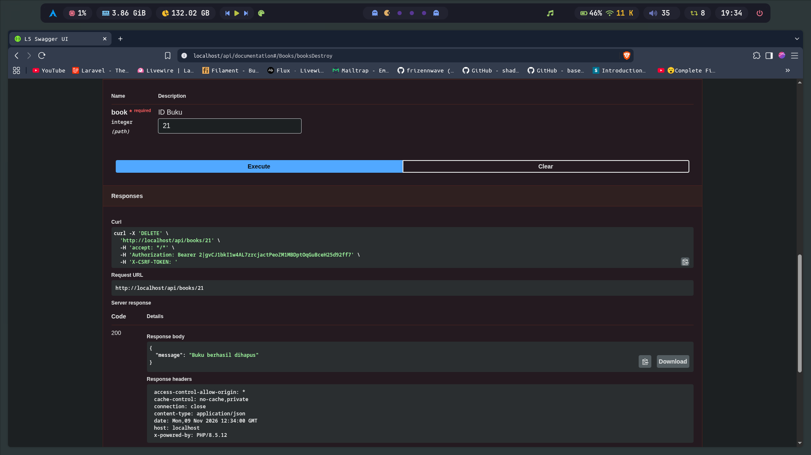

---

### 4. Logout & Token Tidak Berlaku

`POST /api/logout` (status 200)

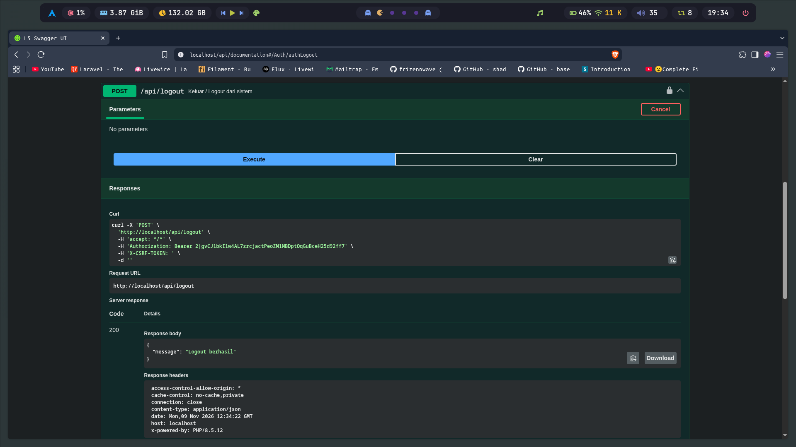

`GET /api/books` setelah logout (status 401)

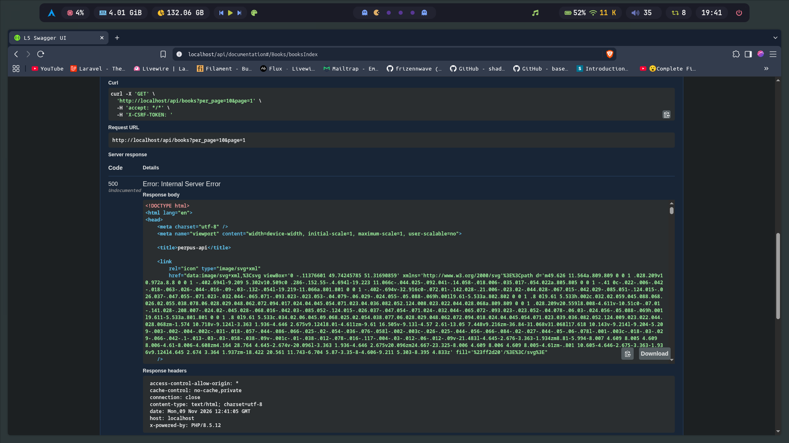

---

### 5. (Opsional) Pengujian dengan cURL / Postman

📸 **Bukti: hasil request lewat cURL dan Postman**

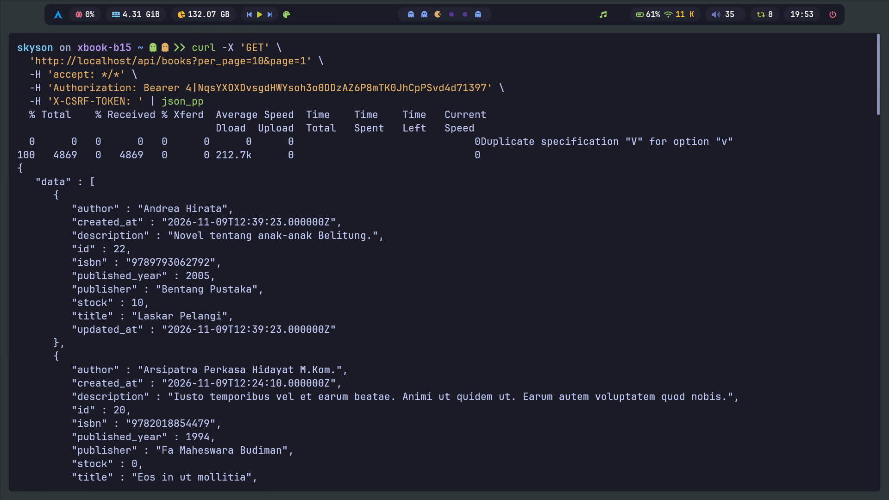

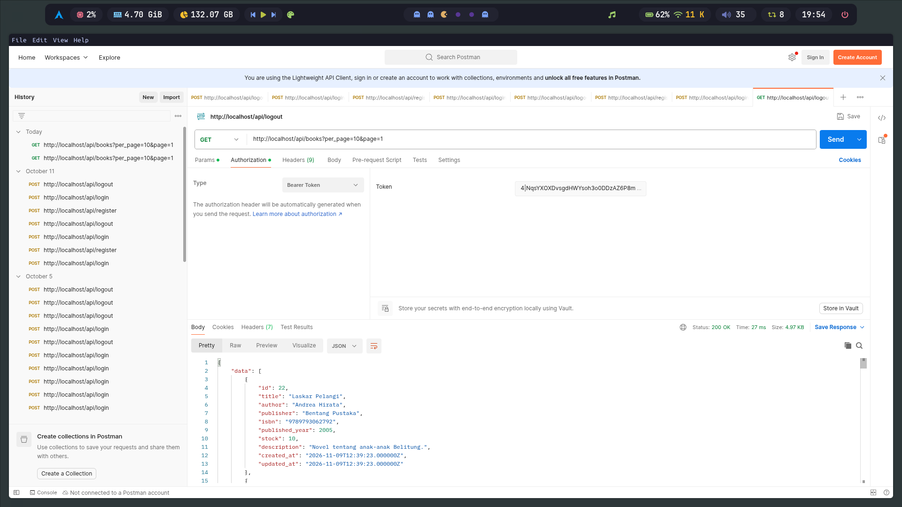

---

### 6. (Opsional) Pengujian Otomatis

```bash
php artisan test
```

hasil `php artisan test` (semua test hijau)

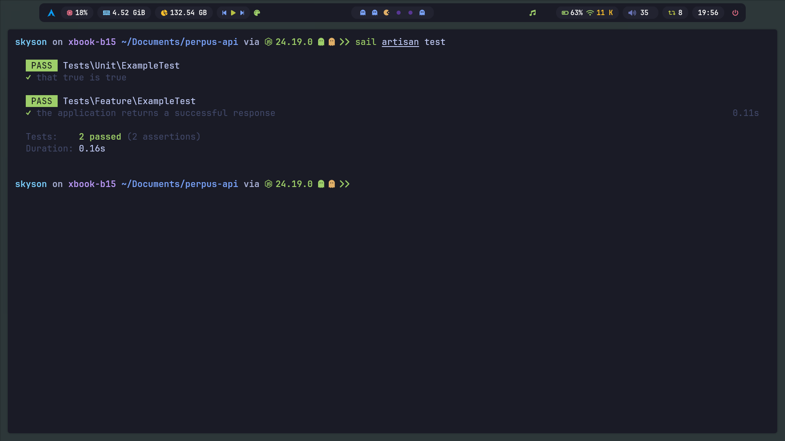

---

## 📄 Lisensi

Proyek ini dibuat untuk keperluan pembelajaran. Laravel adalah framework open-source berlisensi [MIT](https://opensource.org/licenses/MIT).
